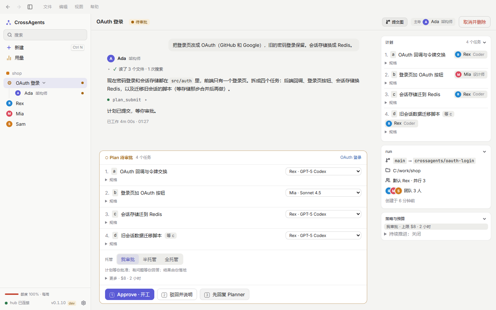
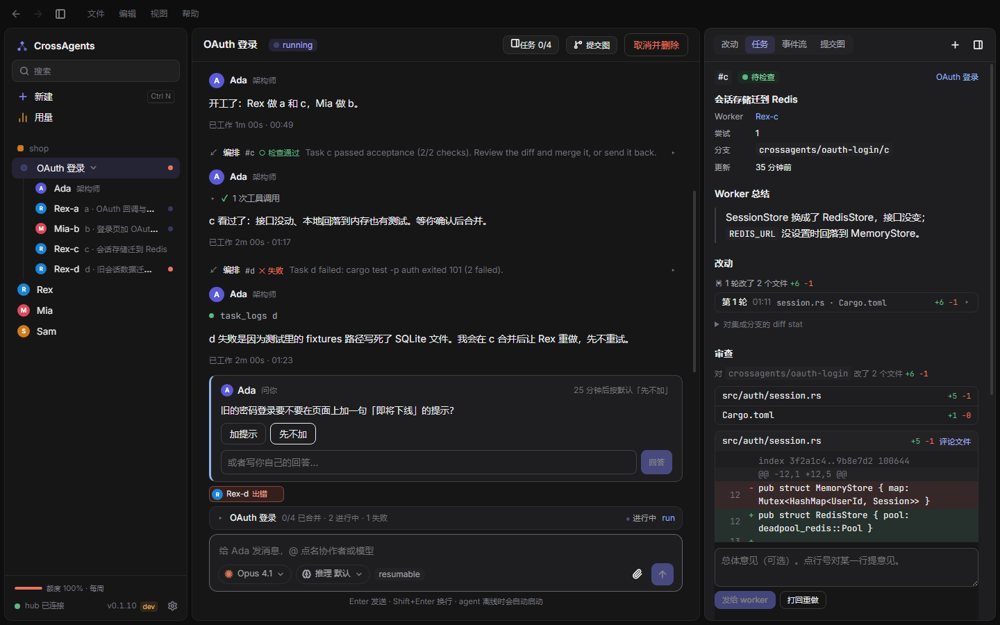
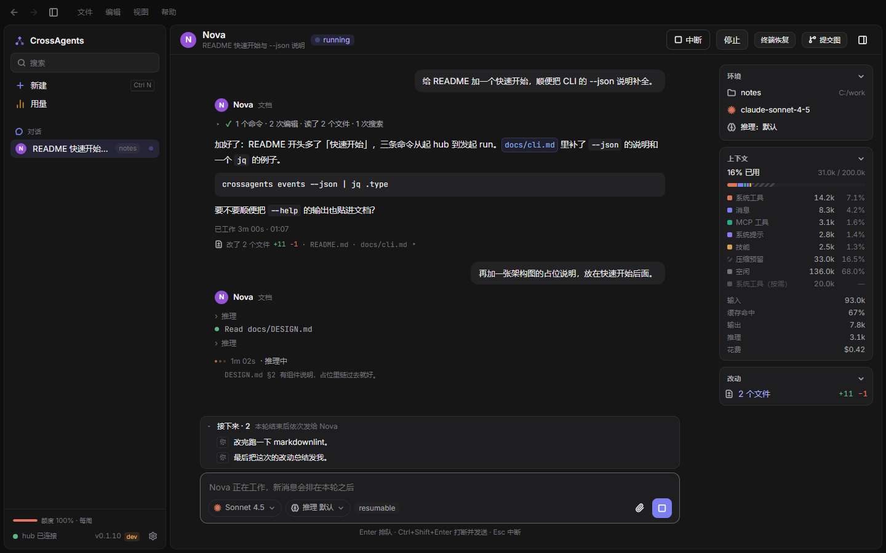

# CrossAgents

**Coding agents from different vendors, working as one team, where you can watch.**

Claude Code, Codex, WorkBuddy and any ACP agent can recruit each other, split the work, hand off and review in one conversation.
Every task runs in its own git worktree, the hub runs its acceptance checks, and you decide what lands.

[Download the latest release](../../releases/latest) · [中文](README.md)

> The screenshots show the Chinese UI.

## How a run goes

**1. Say what you want; the lead writes a plan.** The lead reads the code, splits the request into tasks with a spec and acceptance commands each, and assigns them to teammates. You can reassign any task, then pick how hands-off to be: you approve, semi-managed, or fully managed.

**2. Teammates work in parallel and ask when unsure.** Each task gets a fresh worktree. When an agent needs a decision, it asks in the chat with options. If you don't answer in time, it takes the default.

**3. Getting stuck is handled.** A task that fails acceptance goes back for rework. After repeated failures it escalates to a stronger teammate. When an account runs out of quota, the task moves to another account. Every handoff stays on the task card, with who and why.

**4. You review, you land.** When a task finishes, you read its whole diff. You can comment on any line, then send the comments to the worker or send the task back. Once every task is merged into the run branch, you decide whether it lands on main.

## When something fails, you see why

**Trace** lists every round, command, exit code and cost for each task. The first failure is expanded in red. A task that hit errors and still passed is folded in grey.

The **commit graph** draws main, the run branch and each task branch. Click a merge commit to see what it brought in.

## Or just talk to one agent

You don't need a run to work with a teammate: you can chat with one directly. Tool calls fold into one line, a running command streams its output, and new messages queue after the current turn. The side panel shows context usage, cache hits and cost.

## Install

1. Download `CrossAgents-Setup-<version>.exe` from [Releases](../../releases/latest) and run it. It installs for the current user and needs no administrator rights. The installer includes the matching `crossagents.exe` hub, which the app starts for you.
2. Sign in to at least one agent in a terminal:
   - **Claude Code**: `claude auth login` (signing in to the desktop app is not enough)
   - **Codex**: `codex login`, or import an existing login from the app's account manager
   - **WorkBuddy**: install the CodeBuddy CLI (`npm install -g @tencent-ai/codebuddy-code`) and sign in once with `/login`
3. Add a teammate in the app, pick a model, and start.

The app updates itself. It downloads new versions from this repository in the background and installs them when you quit.

The installer is not code-signed yet, so the first time you run it, Windows SmartScreen may warn about it. Choose "More info → Run anyway".

> This repository holds only release builds; the source is private. The projects and conversations in the screenshots are demo data.
