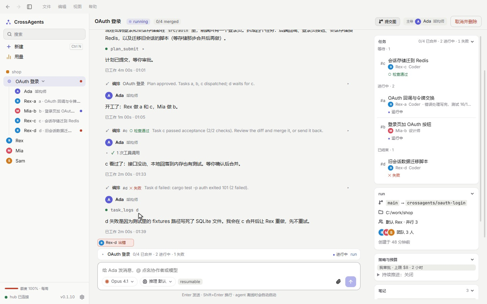
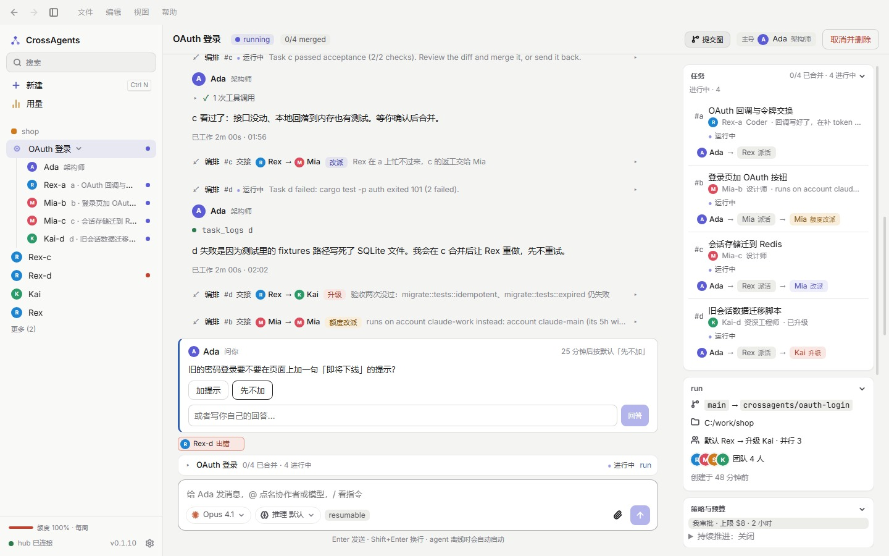
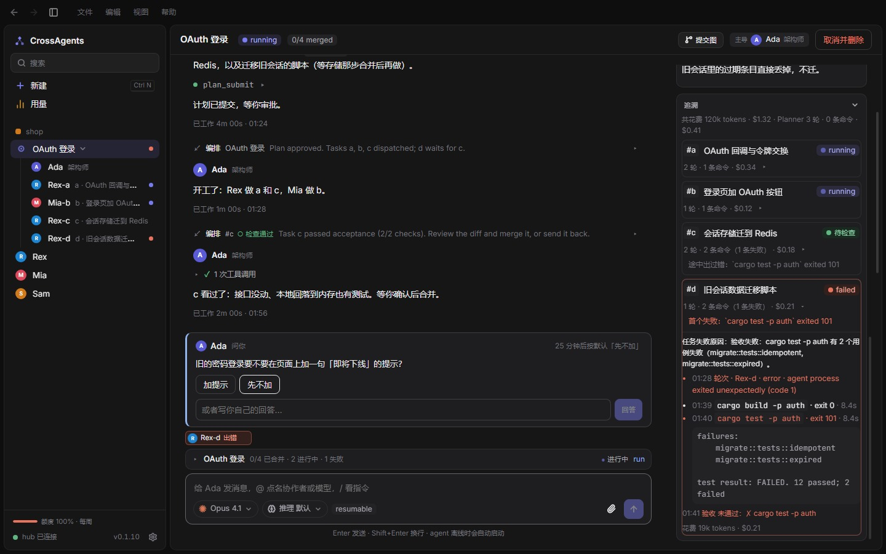
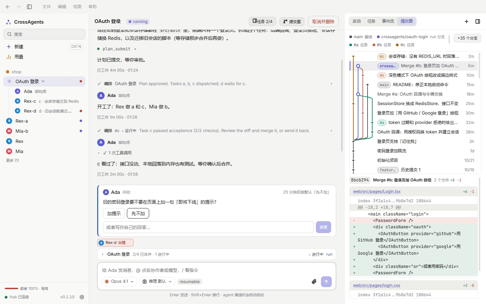

# CrossAgents

让编码 agent 组成一个团队。

**[下载 Windows 版](../../releases/latest)** · [网站](https://l1nkkkk.github.io/CrossAgents-releases/) · [English](README.en.md)

| 交接 | 追溯 | 提交图 |
|---|---|---|
|  |  |  |

## 开始

1. 运行 `CrossAgents-Setup-<版本>.exe`
2. 登录一个 agent：

   | Agent | |
   |---|---|
   | Claude Code | `claude auth login` |
   | Codex | `codex login` |
   | WorkBuddy | `npm install -g @tencent-ai/codebuddy-code`，再在 `codebuddy` 里 `/login` |

按用户安装，自动更新。安装包未签名，SmartScreen 提示时选「更多信息 → 仍要运行」。源码私有，这里只放发布版本；画面中均为演示数据。
